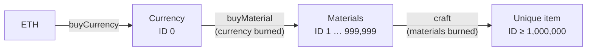

# On-Chain Game Economy – Upgradeable ERC-1155

An upgradeable ERC-1155 contract that runs a small game economy fully on-chain: players buy
**currency** with ETH, spend it on **materials**, and burn materials to **craft unique items**.
The contract sits behind a **UUPS proxy** and was upgraded live on Sepolia from V1 to V2 without
losing any state.

**Highlights**

- Live UUPS upgrade on Sepolia (V1 → V2): balances, recipes and prices survived, the new batch purchase works
- All contracts verified on Etherscan, full buy → craft → upgrade run documented with transaction links
- Economy designed against free mints and inflation: no minter role, value only enters through ETH
- Debugged a deployment that broke after a hard fork repriced contract creation (see [Problems & Solutions](#problems--solutions))
- 8 Foundry tests covering purchases, crafting, pausing, access control and the upgrade

**Stack:** Solidity 0.8.24 · Foundry · OpenZeppelin Contracts Upgradeable v5 · UUPS · Sepolia

---

## Economy Design



| Token ID range | Meaning                                   | Type             |
| -------------- | ----------------------------------------- | ---------------- |
| `0`            | Currency                                  | fungible         |
| `1 … 999_999`  | Materials (wood = 1, iron = 2 on Sepolia) | fungible         |
| `≥ 1_000_000`  | Crafted items                             | unique, supply 1 |

**Source of value.** The only way value enters the economy is `buyCurrency`: one currency unit
costs a fixed amount of ETH (`0.0001 ETH` on Sepolia), and `msg.value` must match exactly. A fixed
price gives currency a stable anchor and lets the admin withdraw the ETH that flowed in.

**Sinks.** Every step burns what it consumes: currency is burned when buying materials, materials
are burned when crafting. Nothing is recycled for free, so supply only grows when someone pays.

**Inflation control.**

- **No minter role.** Tokens are only created through the game rules (`buyCurrency`, `buyMaterial`,
  `craft`). A free-minting role would break the economy and be one more key to protect.
- **No free materials.** A material only exists once it has a non-zero price. Checking only the ID
  range would have let anyone mint unpriced materials for `amount * 0 = 0`.
- **Fixed recipe.** `craft()` takes no parameters and always uses the stored recipe, so players
  cannot craft with a cheaper recipe of their own.

**Two price units.** `currencyPrice` is in wei per currency unit; `materialPrice` is in currency
units. ETH only appears in `buyCurrency` – everything after that is priced in the game currency.

**What I would add in a real game:** dynamic material prices based on demand, item rarity tiers
with different recipes, and per-player daily limits to slow down farming.

---

## Deployment (Sepolia)

| Contract                   | Address |
| -------------------------- | ------- |
| **Proxy** (stays the same) | [`0xa4c7A3CB5Cc3c04b711b9B55439b20Fa16886dba`](https://sepolia.etherscan.io/address/0xa4c7A3CB5Cc3c04b711b9B55439b20Fa16886dba) |
| Implementation **V1**      | [`0xAE9844eb8a79C99Ad6D4C217619f3cB10110e071`](https://sepolia.etherscan.io/address/0xAE9844eb8a79C99Ad6D4C217619f3cB10110e071) |
| Implementation **V2**      | [`0x29B1BCc52d9a6C54e86728f8cA3FAB9C9751f2C3`](https://sepolia.etherscan.io/address/0x29B1BCc52d9a6C54e86728f8cA3FAB9C9751f2C3) |

All three contracts are verified on Etherscan.

### Live end-to-end run

**V1 – buy → craft**

| Step                         | Transaction |
| ---------------------------- | ----------- |
| `buyCurrency(40)`            | [`0xcfec…ec18`](https://sepolia.etherscan.io/tx/0xcfecd0422f11e6da8ec468e910e06e41049ab846de66f2d3dbe6770098b7ec18) |
| `buyMaterial(1, 2)`          | [`0x2f58…ad2b`](https://sepolia.etherscan.io/tx/0x2f584eda18b388a5e66f25c5eb4924fa2aedf059cf1a242f810850f48c21ad2b) |
| `buyMaterial(2, 3)`          | [`0x7d67…d454`](https://sepolia.etherscan.io/tx/0x7d6756eee6a73a555d24c034fd8a0926f3fc5be4b737cf7b36e3e9b6b8ebd454) |
| `craft()` → item `1_000_000` | [`0xef67…1804`](https://sepolia.etherscan.io/tx/0xef6772c66e1b92ccfe0347f3ade7db3e22f71d2dd84ea1b29c6620e914321804) |

**Upgrade V1 → V2**

| Step                       | Transaction |
| -------------------------- | ----------- |
| `upgradeToAndCall(V2, "")` | [`0x91ca…b3d6`](https://sepolia.etherscan.io/tx/0x91ca15f5f4233a011db3fda0d0c40d0f7716f885f62d3aaa5e9d6165549bd3b6) |

**After the upgrade – state kept, new feature works**

- `version()` on the proxy returns `"2"`
- `balanceOf(deployer, 1_000_000)` still returns `1` → the item crafted in V1 survived the upgrade

| Step                                   | Transaction |
| -------------------------------------- | ----------- |
| `buyCurrency(40)`                      | [`0x3026…8f19`](https://sepolia.etherscan.io/tx/0x3026daae4e22246bbcb9a1d5683b5113b9c39b9b83ba3278d1f45ed6a6b48f19) |
| `buyMaterialsBatch([1,2], [2,3])` (V2) | [`0x439b…f3aa`](https://sepolia.etherscan.io/tx/0x439bbaae7a1f4ec88f6ae38e27752615ae97b7051c37949f09776efc841ff3aa) |

---

## Tests

8 Foundry tests, all passing:

| Test | What it proves |
| ---- | -------------- |
| `test_buyCurrency_wrongPayment_revertsIncorrectPayment` | Currency can only be bought with the exact ETH amount |
| `test_buyMaterial_withCurrency_mintsCorrectMaterials` | Paying currency mints the correct materials |
| `test_craft_withMaterials_burnsRecipeAndMintsUniqueItem` | Crafting burns the recipe and mints a unique item |
| `test_endToEnd_buyCurrency_buyMaterials_craft` | The full buy → craft flow works in one run |
| `test_pause_blocksPurchasesAndCrafting` | Pausing blocks currency purchases, material purchases and crafting |
| `test_setMaterialPrice_nonGameAdmin_reverts` | Only the game admin can change material prices |
| `test_upgrade_toV2_preservesState` | Upgrading to V2 keeps balances, recipes and prices |
| `test_v2_buyMaterialsBatch_mintsAllMaterials` | The new V2 batch purchase mints all materials in one transaction |

```bash
forge test -vv
```

---

## Design Decisions

**Recipe as two parallel arrays, not a mapping.** A mapping cannot be iterated – `craft()` would
not know which material IDs to burn. Two arrays (`ids[i]` ↔ `amounts[i]`) capped by
`MAX_RECIPE_SIZE = 5` keep the loop bounded and can be passed straight into `_burnBatch`.

**Pause only where needed.** I used `PausableUpgradeable` with `whenNotPaused` on the value paths
instead of `ERC1155Pausable`, which would also block normal transfers between players.

**Unique IDs never reused.** `nextUniqueId` starts at `1_000_000`, is incremented before minting,
and `craft()` additionally checks `!exists(itemId)` via `ERC1155Supply`.

**ETH withdrawal.** An admin ETH withdrawal only makes sense if ETH actually flows into the
contract – one more reason for the fixed-price currency sale over a faucet.

---

## Upgrade Design

- **UUPS instead of Transparent:** cheaper per call (no admin check in the proxy), and the upgrade
  rule lives in my code: `_authorizeUpgrade` is restricted to `UPGRADER_ROLE`.
- **No constructor logic.** All setup happens in `initialize()` (guarded by `initializer`). The
  constructor only calls `_disableInitializers()` so nobody can initialize the implementation itself.
- **No values assigned at declaration** (e.g. `uint256 currencyPrice = …`) – that would only run in
  the implementation's constructor, never in the proxy.
- **V2 inherits V1** (`contract GameEconomyV2 is GameEconomy`), so the storage layout is identical
  by construction. V2 adds **no new state variables**, only a constant, an event and an error – none
  of them use storage. `@custom:oz-upgrades-from GameEconomy` lets the plugin compare both layouts.
- **No V2 initializer.** The proxy was already initialized by V1 and V2 adds no state, so there is
  nothing to initialize (`@custom:oz-upgrades-unsafe-allow missing-initializer`). If V2 added state
  with start values, I would add a `reinitializer(2)` function and pass it as the call data of
  `upgradeProxy`.
- **Trust assumption.** Upgradeability means the upgrader can change the rules. On Sepolia all roles
  belong to my deployer wallet; in production I would give `UPGRADER_ROLE` and `DEFAULT_ADMIN_ROLE`
  to a multisig behind a timelock.

---

## Security Choices

- **Checks-Effects-Interactions** in every value path; comments mark the three sections.
- **`nonReentrant` on everything that moves value** – not just `withdraw`: `_mint` / `_mintBatch`
  call `onERC1155Received` on contract recipients, which is an external call as well.
- **`ReentrancyGuardTransient`** (EIP-1153 transient storage): no constructor and no storage slot,
  so it is safe behind a proxy and cheaper.
- **AccessControl with least privilege:** `PAUSER_ROLE`, `UPGRADER_ROLE`, `GAME_ADMIN_ROLE`,
  `DEFAULT_ADMIN_ROLE` (withdraw). Zero addresses are rejected in `initialize`.
- **ETH sent with `call`**, success checked, instead of `transfer` (fixed 2300 gas stipend).
- **Bounded loops only** (`MAX_RECIPE_SIZE`, `MAX_BATCH_SIZE`), custom errors everywhere, no `tx.origin`.
- **Private key in an encrypted Foundry keystore** (`cast wallet import`), not in `.env`.

**Linter warnings I kept on purpose:**
`arbitrary-send-eth` (withdraw sends to a chosen address – admin-only by design),
`require-revert-in-loop` (an invalid recipe or batch must be rejected as a whole; loops are bounded),
`reentrancy-events` (events after `_mint` / `call` – all of these functions are `nonReentrant`;
for `setMaterialPrice` / `setRecipe` there is no external call, so it is a false positive).

---

## Problems & Solutions

**1. Deployment ran out of gas after an Ethereum hard fork.**
`forge test` passed, but the implementation deployment failed every time – even with a 4× gas
multiplier – and the proxy failed after it because its implementation did not exist.
`cast code` showed no code at the implementation address. `cast run <txHash>` showed the
constructor finished (`Initialized` event) and returned the runtime bytecode, then **OutOfGas**
while storing it. The cause: on 6 October 2026 Sepolia activated **Glamsterdam**, including
**EIP-8037**, which makes creating new state much more expensive – code deposit went from 200 to
1,530 gas per byte. Foundry's local simulation still used the old prices, so its gas limits were far
too low. `cast estimate --create …` asked the Sepolia node directly: **19.18 M gas** instead of the
~2.7 M Foundry estimated. Fix: `--gas-estimate-multiplier 800 --slow` (`--slow` sends transactions
one by one, so the proxy is only deployed once the implementation exists). Lesson: hard forks
reprice opcodes, so estimates can be wrong right after an upgrade – the same reason the fixed
2300-gas stipend of `transfer()` is considered unsafe.

**2. Design bug caught before deploying.**
My first `buyMaterial` only checked the ID range – unpriced materials would have been free. I now
check `materialPrice[id] != 0` instead.

**3. `ReentrancyGuard` has a constructor.**
Upgrade validation rejected the contract: the regular `ReentrancyGuard` has a constructor that
would never run in the proxy. Fix: `ReentrancyGuardTransient` (transient storage, no constructor,
no storage slot) plus `evm_version = "cancun"`, because transient storage only exists since the
Cancun upgrade and Solidity 0.8.24 compiles for an older EVM by default.

**4. Upgrade test reverted with `AccessControlUnauthorizedAccount`.**
I wrote `vm.prank(upgrader); proxy.upgradeToAndCall(address(new GameEconomyV2()), "");`. The
`new GameEconomyV2()` is itself a call and consumed the prank, so the upgrade ran as the test
contract. Fix: deploy V2 first, then `vm.prank`. Nice side effect: the revert proved that
`_authorizeUpgrade` rejects unauthorized callers.

**5. "Missing initializer" when upgrading to V2.**
The plugin expects every upgradeable contract to define its own initializer. V2 intentionally has
none (see [Upgrade Design](#upgrade-design)), so I documented that with
`@custom:oz-upgrades-unsafe-allow missing-initializer`.

**6. Upgrade validation could not start on Windows.**
The plugin runs `bash -c "npx @openzeppelin/upgrades-core …"` via FFI. On Windows `bash` resolved
to the WSL launcher (no distro installed). Fix: `OPENZEPPELIN_BASH_PATH` in `.env` pointing to Git Bash.

---

## What I Learned

- **How a proxy really works:** the proxy holds all state and `delegatecall`s into the
  implementation, so the code runs on the proxy's storage. An upgrade only swaps the code address –
  same proxy address, same balances.
- **`msg.value` is only ETH.** Paying with an ERC-1155 currency means checking `balanceOf` and
  burning – the tokens already live inside the contract, so no approval is needed.
- **Gas costs are not fixed.** A hard fork changed deployment costs by ~7× and broke my deploy even
  though all tests passed.
- How to debug failed transactions with `cast run` and `cast estimate` instead of guessing.

---

## Tools & Commands

- **Foundry** (forge, cast) – build, test, deploy, interact
- **OpenZeppelin Contracts / Contracts Upgradeable v5.7.0** – ERC-1155, AccessControl, Pausable, UUPS, ReentrancyGuardTransient (the deployed contracts were compiled with an earlier v5 release)
- **openzeppelin-foundry-upgrades** – deploys the proxy and validates upgrade safety (constructor, initializer, storage layout)
- **Alchemy** – Sepolia RPC endpoint
- Solidity `0.8.24`, `evm_version = "cancun"`, optimizer on (200 runs)

```bash
# build & test
forge build
forge test -vv

# deploy V1 behind a UUPS proxy (+ material prices + recipe)
forge clean
forge script script/GameEconomy.s.sol --rpc-url sepolia --account dev-wallet \
  --broadcast --verify --gas-estimate-multiplier 800 --slow

# upgrade the proxy to V2
forge clean
forge script script/UpgradeGameEconomy.s.sol --rpc-url sepolia --account dev-wallet \
  --broadcast --verify --gas-estimate-multiplier 800 --slow

# check the upgrade
cast call <PROXY> "version()(string)" --rpc-url sepolia
cast call <PROXY> "balanceOf(address,uint256)(uint256)" <ADDRESS> 1000000 --rpc-url sepolia
```

The high gas multiplier is explained under [Problems & Solutions](#problems--solutions).
